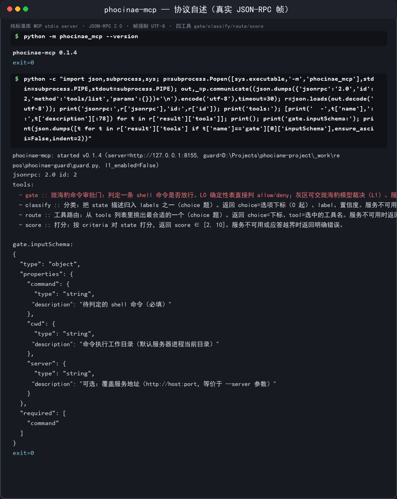
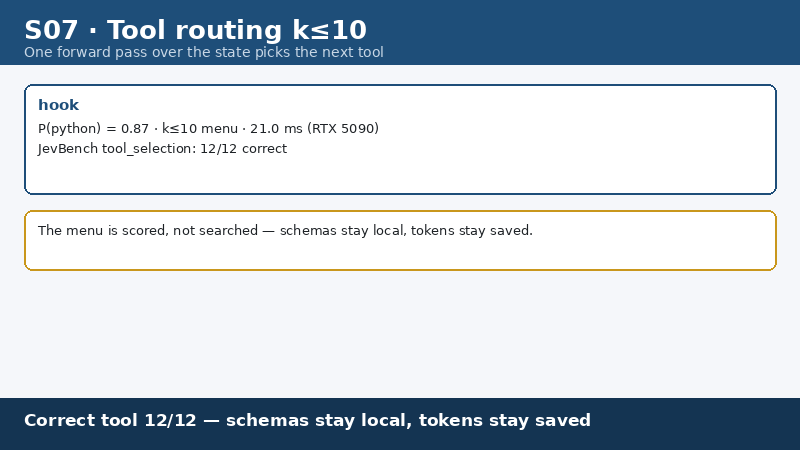
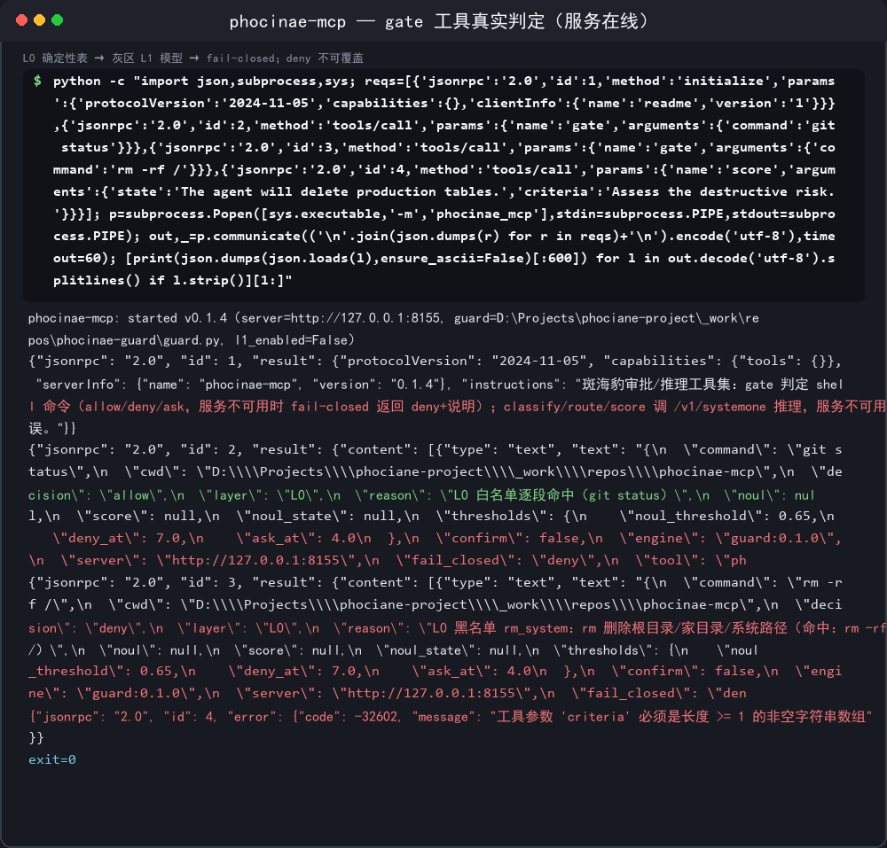
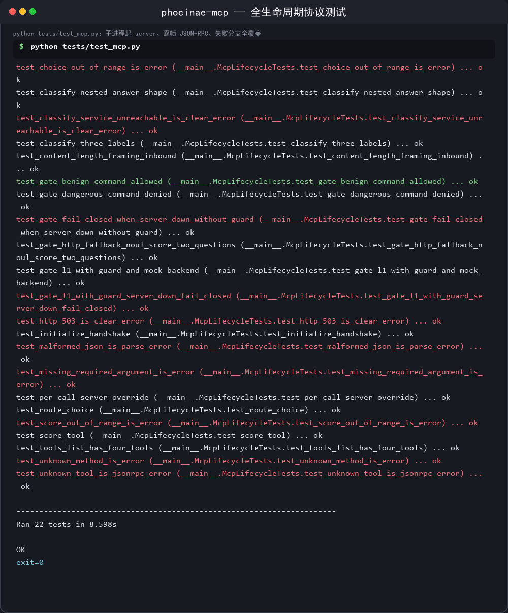

# phocinae-mcp

把斑海豹的**命令审批门**与 **P0 推理协议**暴露为 MCP 工具（`gate` / `classify` / `route` / `score`），接入只读 MCP 的编码代理。**双代协议并存**：现代面（2026-07-28，含 `server/discover`、MRTR 交互、Streamable HTTP）与 2024-11-05 旧客户端兼容。

<p>
  
  
  
  
</p>


<p><sub>▲ `tools/list` 的真实应答：四个工具的参数与返回形状</sub></p>

斑海豹生态的 MCP server：把斑海豹的命令审批与推理能力以 4 个工具暴露给
MCP 客户端。**纯标准库**（Python ≥ 3.8，零第三方依赖），支持 **stdio** 与
**Streamable HTTP** 两种传输，**MCP 2026-07-28 对齐**并**兼容 2024-11-05
旧客户端**。

> 本仓库为本地增强版（基于 PyPI phocinae-mcp 0.1.1），仅用于本地开发与
> 协议对齐验证，**不发布**。

## 工具


<p><sub>▲ **合成演示动画**（模型仓 docs/gallery [S07](https://huggingface.co/Phocinae/Phocinae-Largha-150M-v1/blob/main/docs/gallery)）：画面为逐帧渲染、场景数据虚构，但它演示的 **`route` 工具「一次前向在候选工具里选出该用的那个」的判定过程** 与真实实现一致（本页上方的终端截图即真实运行的同一流程）。</sub></p>

| 工具 | 作用 | 输入 | 输出 |
|------|------|------|------|
| `gate` | 判定 shell 命令能否执行 | `command`、`cwd?`、`server?` | `decision` ∈ allow/deny/ask + `layer`/`reason` |
| `classify` | 把状态归入候选标签之一 | `state`、`labels` | `choice`（下标）+ `label` |
| `route` | 从候选工具中选最合适的一个 | `state`、`tools` | `choice` + `tool` |
| `score` | 按标准给状态打 2–10 分 | `state`、`criteria` | `score` + `range` |

**fail-closed**：斑海豹 P0 服务（`/v1/systemone`）不可用、超时、应答异常时，
`gate` 一律返回 `deny`（带原因），`classify`/`route`/`score` 返回 `isError: true`。

## 传输方式

### stdio（默认）

```bash
python3 -m phocinae_mcp --server http://127.0.0.1:8155
```

MCP 客户端以子进程方式拉起，走 stdin/stdout 逐行 JSON-RPC 帧。
**stdout 纯净性保证**：stdout 只输出 JSON-RPC 帧；一切日志（启动、告警、
工具内部异常）只走 stderr（`phocinae-mcp[level]:` 前缀）。guard.py 导入期
的打印也被重定向到 stderr，不会污染协议通道。

### Streamable HTTP（新增，2026-07-28）

```bash
python3 -m phocinae_mcp --transport http --host 127.0.0.1 --port 8255
# --port 0 → 随机端口（测试用）；端口号打印在 stderr
```

- **仅回环绑定**：`--host` 只接受 `127.0.0.1` / `localhost` / `::1`，
  其他地址直接拒绝启动（exit 2）；
- 端点 `POST /mcp`；通知 → `202 Accepted`（空 body）；请求 → `200`
  单对象 JSON；
- **请求头强制**（Server Validation）：`MCP-Protocol-Version` 必带且须受
  支持（否则 `400` + `-32020`/`-32022`）、`Mcp-Method` 必带且等于 body
  的 method（`tools/call`、`resources/read` 还必带 `Mcp-Name` 等于
  `name`/`uri`），违者 `400 -32020`；`Accept` 未含 `application/json` /
  `text/event-stream` → `406`；未知方法 → `404 -32601`；`GET`/`DELETE`
  → `405`（2026-07-28 已移除 GET 流与会话终结端点）；
- 无会话头（`Mcp-Session-Id`）、无 SSE 恢复缓冲——无状态服务，可任意重启。

环境变量：`PHOCINAE_MCP_TRANSPORT=stdio|http`、`PHOCINAE_MCP_HTTP_PORT`
可替代命令行开关。

## 协议对齐（2026-07-28）

双代并存，**按请求逐条分派**：

- 带 `params._meta`（含 `io.modelcontextprotocol/*` 键）的请求、以及
  `server/discover`、`resources/*` → **现代面**；
- `initialize` 握手、无 `_meta` 的请求 → **旧年代**（2024-11-05 行为，
  与原版 0.1.x 一致）。

现代面补足项：

| 项 | 实现 |
|----|------|
| `server/discover` | 必实现：`supportedVersions`、`capabilities`、`_meta.serverInfo`、`instructions`，`ttlMs=3600000`、`cacheScope=public` |
| `_meta` 校验 | 逐请求必填 `protocolVersion` + `clientCapabilities`，缺失 → `-32602`；版本不支持 → `-32022`（`data.supported`/`data.requested`） |
| `resultType` | 一切结果携带（`complete` / `input_required`） |
| `ttlMs`/`cacheScope` | `discover`、`tools/list`、`resources/*`（静态内容，`public` 共享缓存） |
| 多轮交互（MRTR） | `gate` 返回 `ask` 且客户端声明 `elicitation` 能力时 → `resultType=input_required` + `inputRequests.gate_confirmation`（`elicitation/create`，form）+ `requestState`；回执 `accept`/`decline`/`cancel` → allow/deny/不授权；`requestState` 为 **HMAC-SHA256 防篡改 + 10 分钟过期 + 请求指纹（tool+command）比对**，篡改/过期自动重发交互 |
| resources | `resources/list` + `resources/read` 暴露审批策略全文 `phocinae://policy/gate-approval`（text/markdown，含 L0/L1/fail-closed 判定链路、阈值、ask 处理义务） |
| 已移除方法 | 现代面下 `initialize`/`ping`/`shutdown`/`logging/setLevel`/`subscriptions/listen` → `-32601`（data 附 supportedVersions） |
| 工具 schema 收紧 | `maxLength`（command/state 20000、cwd 4096、server 2048、列表单项 2000）、`minItems`/`maxItems`（1–100）、`enum`（decision/layer）、`outputSchema` 全量声明（classify/route/score `additionalProperties:false`）；服务端同步执行同口径校验（越限 → `-32602`） |
| description 重写 | 四工具均按「**何时使用 / 何时不使用**」结构重写 |
| 日志 | 全部走 stderr；`_meta` 里 `io.modelcontextprotocol/logLevel` 门控（`info` 起，MCP 级日志协议字段） |

兼容性：旧客户端 `initialize` 握手返回 2024-11-05 能力；无 `_meta` 的
`tools/list`/`tools/call` 按旧年代应答（不报错）——对旧客户端零破坏。

## 运行


<p><sub>▲ `tools/call` 真实判定：L0 定夺安全/危险命令，灰区才调模型</sub></p>

```bash
# stdio（默认）
python3 -m phocinae_mcp [--server http://127.0.0.1:8155] [--timeout 5]
    [--guard /path/to/guard.py] [--l1-enabled] [--model <name>]

# Streamable HTTP
python3 -m phocinae_mcp --transport http [--host 127.0.0.1] [--port 8255]

python3 -m phocinae_mcp --version
```

`--guard`：复用 phocinae-guard 的 guard.py（L0 确定性表 + L1 编排），自动
探测同级 `../phocinae-guard/guard.py`；找不到则 gate 降级为纯 HTTP
noul+score 两问（`engine: "http:noul+score"`）。导入 guard 时不写
`__pycache__`（只读复用）。

## 测试

```bash
python3 tests/test_mcp.py    # stdio 双代全流程冒烟 → tests/mcp_smoke.txt
python3 tests/test_http.py   # Streamable HTTP 冒烟 → tests/http_smoke.txt
```

- `test_mcp.py`：模拟 MCP 客户端，走 stdio 依次执行旧年代
  initialize → notifications/initialized → ping → tools/list → tools/call
  全工具矩阵（含失败分支）→ shutdown；现代年代 discover → tools/list →
  全工具矩阵（gate allow/deny/ask、MRTR 接受/拒绝/取消/篡改、fail-closed、
  schema 越限、`-32602`/`-32022`/`-32601`、resources）→ 通知。同时对 stdout
  逐行审计（每行必须是 JSON-RPC 帧、日志零泄漏、无 traceback）。
- `test_http.py`：HTTP 头校验矩阵（`-32020`/`-32022`/`406`/`405`/`404`/
  `202`）+ MRTR 全链路 + resources。
- 两个测试共用 `tests/mock_systemone.py`（确定性 mock P0 服务，不跑模型）。

## 目录

```
phocinae_mcp/
├── server.py          主程序：双代分派、MRTR、CLI（stdio/http）
├── http_transport.py  Streamable HTTP（新增）
├── protocol.py        2026-07-28 共享件（新增）：版本/错误码/_meta 校验/
│                      resultType/ttlMs/cacheScope/HMAC requestState/策略文本/日志门控
├── tools.py           四工具 + 收紧后的 schema（description 重写）
├── backend.py         斑海豹 P0 客户端（原版不动）
├── guard_bridge.py    guard.py 复用桥（+stdout 纯净性防护）
└── __init__.py / __main__.py
tests/
├── test_mcp.py        stdio 全流程冒烟 → mcp_smoke.txt
├── test_http.py       HTTP 冒烟 → http_smoke.txt
└── mock_systemone.py  确定性 mock P0 服务
```

## 安全声明（与斑海豹生态同口径）


<p><sub>▲ `test_mcp.py` 42/42 + `test_http.py` 18/18：帧强制 UTF-8，与 locale 无关（这是 0.1.x 上真实存在的缺陷）</sub></p>

- `gate` 的 `ask` 结果要求集成方把命令与理由呈现给人工，未获明确批准
  不得执行（现代面走 elicitation 交互，旧年代走结果文本）；
- 判定结果不构成任何法律责任承诺；fail-closed 是唯一默认；
- 审批策略全文见资源 `phocinae://policy/gate-approval`（`resources/read`）。
